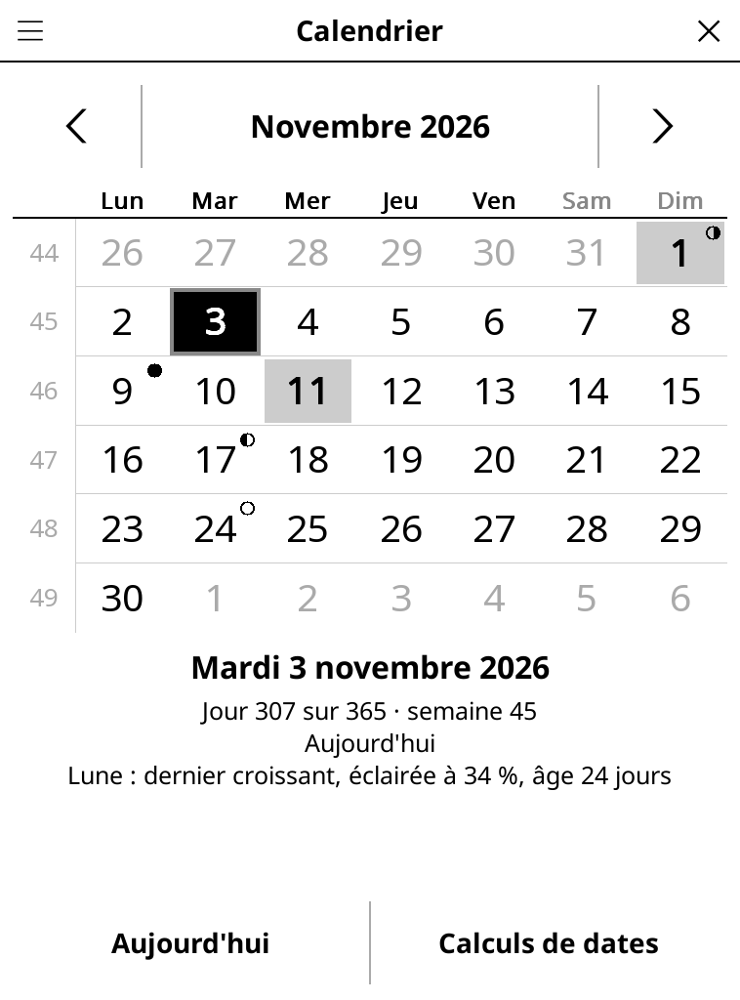

# almanac.koplugin

A calendar for [KOReader](https://github.com/koreader/koreader): month view,
public holidays, moon phases and a date calculator.
French name: *Calendrier*.

## Screenshot

## Features

- **Month view** — ISO week numbers, today in black, public holidays on grey,
  the selected day framed, days of the next/previous month in grey. Monday
  first (Sunday when the holidays are those of the US or English Canada,
  or set it in ☰ → *Week starts on*).
- **Navigation** — swipe left/right or the arrows to change month; tap the
  month name to jump to a date (`03/11/2026`, `2026-11-03`), a month
  (`11/2026`) or a year (`1969`); *Today* comes back.
- **Tap a day** — weekday, day of the year, ISO week, how far from today,
  holidays, and the moon: the time of a new/full moon or quarter that day,
  otherwise the phase, illumination and age.
- **Moon phases** — ● new moon, ◐ first quarter, ○ full moon, ◑ last
  quarter, drawn in the corner of the day. Computed with Meeus' algorithms
  (accurate to a few minutes), shown in the reader's time zone.
- **Date calculator**
  - days between two dates, with or without the end day, plus working days
    (Monday–Friday without the chosen country's holidays);
  - a date plus or minus days, weeks, months or years (`+10`, `-3w`, `2m`,
    `1y`; French `s` for weeks and `a` for years work too);
  - the weekday of any date;
  - an age from a birth date, in years, months and days, and the next
    birthday.

## Public holidays

National holidays only (☰ → *Holidays*); the default follows the UI language:

| Country | Holidays |
|---|---|
| France | the 11 public holidays (Easter Monday, Ascension, Whit Monday computed from Easter); **Alsace-Moselle** option adds Good Friday and 26 December |
| United Kingdom | England & Wales bank holidays, substitute days, moved and one-off holidays (jubilees, coronation) |
| United States | federal holidays, with the Friday/Monday observed days |
| Germany | the 9 nationwide holidays |
| Spain | the national holidays common to all regions |
| Belgium | the 10 legal holidays |
| Switzerland | National Day and the holidays kept by most cantons |
| Canada | federal statutory holidays |

Regional holidays (German Länder, Spanish regions, cantons, provinces, US
states) are not included.

## Where to find it

Tools → Calendar.

## License

GPL-3.0
